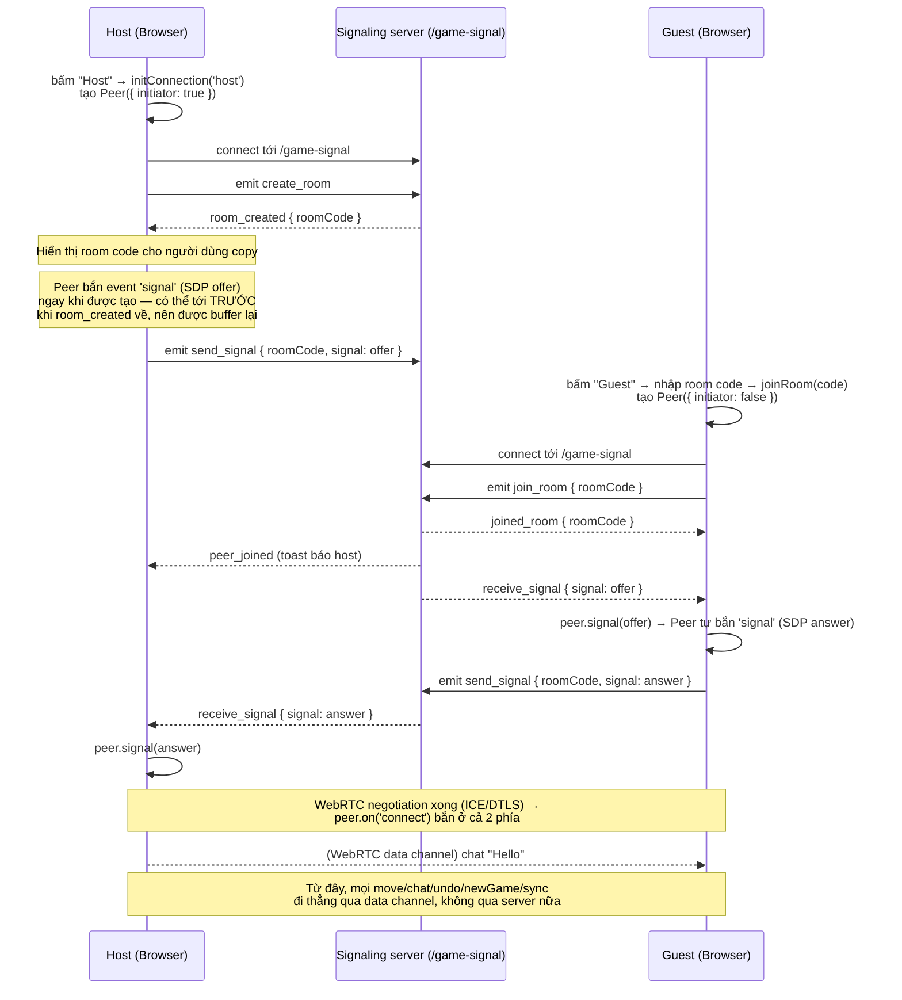

# Game signaling (Caro/Connect4 online mode)

Tài liệu này giải thích cơ chế **tự động thiết lập kết nối peer-to-peer (WebRTC)**
giữa hai người chơi Caro/Connect4 ở chế độ `online`: vấn đề nó giải quyết, luồng hoạt
động chi tiết, và các file liên quan trong codebase.

## 1. Vấn đề cần giải quyết

Caro/Connect4 chơi online bằng cách 2 trình duyệt kết nối **trực tiếp** với nhau qua
WebRTC data channel (thư viện [`simple-peer`](https://github.com/feross/simple-peer)) —
không có server nào đứng giữa để xử lý nước đi, chat, sync cấu hình bàn cờ.

Vấn đề là: để 2 trình duyệt tìm được nhau và mở được kết nối WebRTC, chúng phải trao
đổi trước với nhau một gói dữ liệu offer/answer (SDP) — đây gọi là bước **signaling**.
WebRTC cố tình không quy định cách trao đổi gói này, ứng dụng phải tự lo.

Trước khi có tính năng này, project xử lý signaling theo cách **thủ công**: mỗi bên tạo
`Peer`, nhận về một chuỗi JSON offer/answer rất dài, người dùng phải tự copy chuỗi đó
gửi cho bạn qua một kênh chat khác (Messenger, Zalo,...) rồi dán ngược lại vào app. Bất
tiện, dễ gõ/copy thiếu, và phải làm 2 lượt (host gửi offer → guest gửi lại answer).

**Giải pháp**: thêm một kênh WebSocket (Socket.IO) nhỏ ngay trong chính app, đóng vai
trò "người đưa thư" — tự động chuyển gói offer/answer giữa 2 bên. Người dùng chỉ cần
chia sẻ một **room code 6 ký tự** duy nhất (thay vì cả chuỗi JSON dài), phần còn lại
được tự động hoá hoàn toàn.

> Quan trọng: kênh signaling **không** tham gia vào việc chơi game. Toàn bộ nước đi,
> undo, new game, chat trong lúc chơi vẫn đi thẳng qua WebRTC data channel giữa 2
> trình duyệt như cũ (`peer.send(...)` / `peer.on('data', ...)` trong
> `src/services/caro.utils.ts` và `caro-connection.context.tsx`). Server signaling chỉ
> sống trong khoảnh khắc 2 người bấm Connect cho tới khi kết nối P2P thành công.

## 2. Kiến trúc tổng quan

```
┌─────────────┐                                   ┌─────────────┐
│  Browser A   │                                   │  Browser B   │
│  (Host)      │                                   │  (Guest)     │
└──────┬───────┘                                   └──────┬───────┘
       │        Socket.IO namespace "/game-signal"                │
       │  (room code, SDP offer/answer — chỉ dùng lúc bắt tay)     │
       ├───────────►  signaling-server.mjs  ◄────────────────────┤
       │              (src/server/signaling.mjs)                  │
       │              độc lập với Next.js, cổng riêng              │
       │                                                          │
       │              WebRTC data channel (simple-peer)           │
       └───────────────────────────────────────────────────────►│
                 (move / undo / newGame / chat / sync — trực tiếp,
                  không qua server, dùng suốt ván chơi)
```

Signaling server là một **process hoàn toàn tách biệt** khỏi Next.js — chỉ là Node +
Socket.IO thuần, không import gì từ Next cả. Nhờ vậy:

- Frontend chạy bằng `next dev`/`next start` chuẩn (không cần custom server), deploy
  được lên bất kỳ đâu hỗ trợ Next.js kể cả Vercel.
- Signaling server chạy bằng lệnh riêng (`yarn signal` / `bun run signal` →
  `node signaling-server.mjs`), lắng nghe ở port riêng (mặc định `4001`, cấu hình qua
  `SIGNAL_PORT`).
- Client biết địa chỉ signaling server qua biến môi trường
  `NEXT_PUBLIC_GAME_SIGNAL_URL` (`src/configs/constance.ts` → `GAME_SIGNAL_URL`), luôn
  phải trỏ tới nơi `signaling-server.mjs` đang chạy — kể cả khi chạy local (2 port khác
  nhau trên cùng máy) lẫn khi tách deploy 2 nơi khác nhau (vd: frontend Vercel, server
  một VPS).

Các file liên quan:

- `signaling-server.mjs` (root) — entrypoint đứng một mình: tạo `http.Server` tối
  giản, gọi `attachSignalingServer(httpServer)` để gắn Socket.IO vào, không đụng gì
  tới Next.js.
- `src/server/signaling.mjs` — toàn bộ logic phòng (room) và relay tín hiệu, chạy trên
  namespace `/game-signal`. Đây là phần dùng chung, được `signaling-server.mjs` gọi.
- `src/hooks/useGameSignalingSocket.ts` — hook phía client tạo kết nối Socket.IO tới
  namespace đó (`io('${GAME_SIGNAL_URL}/game-signal')`).
- `src/types/signaling.type.ts` — định nghĩa type cho các event, dùng chung
  client/server để tránh gõ nhầm tên event.
- `src/context/caro-connection.context.tsx` (và bản song song
  `connect4-connection.context.tsx`) — nơi ghép nối `simple-peer` với socket
  signaling: nghe event `signal` của `Peer` để gửi đi, nghe `receive_signal` từ server
  để nạp ngược vào `Peer`.

## 3. Khái niệm "room"

Một **room** là một cặp (host, guest) đang cố gắng ghép đôi, được định danh bằng
**room code** — chuỗi 6 ký tự viết hoa (bỏ các ký tự dễ nhầm như `0/O/1/I`, xem
`ROOM_CODE_CHARS` trong `signaling.mjs`).

Room được lưu **in-memory** trên server (một `Map<roomCode, { hostSocketId,
guestSocketId, createdAt }>`), không có database — vì:

- Room chỉ tồn tại trong vài giây/phút lúc 2 người đang bắt tay.
- App hiện chạy 1 instance Node duy nhất (Docker/VPS), không cần chia sẻ state giữa
  nhiều máy chủ.
- Không có gì cần giữ lâu dài; nếu server restart, các room đang chờ chỉ đơn giản mất
  đi, người chơi bấm Connect lại là xong.

Room tự dọn dẹp trong 2 trường hợp:
1. **Hết hạn**: quá 10 phút (`ROOM_TTL_MS`) mà chưa có guest join → bị xoá bởi một
   `setInterval` chạy mỗi phút (`cleanupExpiredRooms`).
2. **Có người rời/disconnect**: xử lý trong sự kiện `disconnect` (xem phần 5).

## 4. Luồng hoạt động chi tiết (happy path)



Diễn giải từng bước bằng lời:

1. **Host bấm "Connect"** (`HostConnection.tsx` → `initConnection('host')`): tạo ngay
   một `Peer({ initiator: true, trickle: false })`. `trickle: false` nghĩa là
   `simple-peer` gom toàn bộ SDP + ICE candidates thành **một** event `signal` duy nhất
   (thay vì bắn nhiều lần nhỏ giọt) — phù hợp để gửi qua một message socket.
2. Một `useEffect` phát hiện đã có `peer` + đang là `host` + chưa có room code →
   `socket.emit('create_room')`.
3. Server tạo room code ngẫu nhiên (không trùng room đang tồn tại), lưu
   `hostSocketId`, trả về `room_created`. Host hiển thị code này lên UI kèm nút copy
   (`HostConnection.tsx`).
4. **Guest nhập room code, bấm Join** (`GuestConnection.tsx` → `joinRoom(code)`): tạo
   `Peer({ initiator: false, trickle: false })`, rồi `socket.emit('join_room', {
   roomCode })`.
5. Server kiểm tra room tồn tại và chưa có guest → gắn `guestSocketId`, trả
   `joined_room` cho guest, báo `peer_joined` cho host (chỉ để hiện toast thông báo).
6. Ngay khi được tạo, `Peer` của host đã tự bắn `signal` (chứa SDP offer) — không đợi
   ai cả. Vì vậy có thể xảy ra tình huống **race condition**: offer sinh ra trước khi
   `room_created` (và do đó room code) về tới client. Context xử lý việc này bằng một
   cặp `useRef`:
   - `roomCodeRef` giữ giá trị room code mới nhất (đồng bộ ngay lập tức, không đợi
     re-render như state).
   - `pendingSignalRef` giữ tạm signal nếu `roomCodeRef` chưa có gì; khi room code về
     (`flushRoomCode`), nếu có signal đang chờ thì gửi luôn.

   Nhờ vậy dù offer sinh ra "quá sớm", nó vẫn được gửi đi ngay khi room code sẵn sàng,
   không bị rơi mất. Về phía guest thì không có race này vì room code đã biết trước
   (người dùng tự nhập) trước khi `Peer` guest được tạo.
7. Server nhận `send_signal { roomCode, signal }`, tra `roomCode` trong `rooms` để tìm
   **socket còn lại** trong room (không phải người gửi), forward nguyên văn signal qua
   sự kiện `receive_signal`.
8. Bên nhận gọi `peer.signal(receivedSignal)`. Với guest, gọi hàm này lần đầu (nạp
   offer của host) sẽ khiến `simple-peer` tự sinh ra SDP answer, kích hoạt lại chính
   event `signal` phía guest → guest lại `send_signal` answer ngược về host — dùng
   chung một cơ chế gửi/nhận cho cả 2 chiều, không cần phân biệt "đang gửi offer hay
   answer".
9. Khi cả hai đã trao xong offer/answer, WebRTC tự thương lượng xong (ICE, DTLS) và
   bắn `peer.on('connect')` ở **cả hai phía độc lập** — không cần server báo. Lúc này
   `connectionType` chuyển thành `'connected'`, và toàn bộ tương tác trong game (nước
   đi, undo, new game, đồng bộ cấu hình `sync`, chat) đi thẳng qua WebRTC data channel
   như trước khi có tính năng này — xem `peer.on('data', ...)` trong
   `caro-connection.context.tsx`.

## 5. Các trường hợp lỗi / rời phòng

| Tình huống | Xử lý |
| --- | --- |
| Guest nhập room code sai hoặc đã hết hạn | Server trả `room_error { reason: 'Room not found or expired' }`; client toast lỗi, huỷ `Peer` vừa tạo, reset về trạng thái ban đầu để thử lại. |
| Room đã có guest, có người thứ 3 cố join | Server trả `room_error { reason: 'Room is already full' }` (mỗi room chỉ có đúng 1 host + 1 guest). |
| Host đóng tab/mất mạng **trước khi** guest join | Server nhận `disconnect` từ socket host → xoá hẳn room (không ai join được code đó nữa). |
| Host hoặc guest đóng tab/mất mạng **sau khi** đã ghép đôi nhưng WebRTC chưa `connected` xong | Server báo `peer_left` cho người còn lại → toast "Your friend left the room". *(Chỉ hiện toast này nếu game **chưa** `connected` — xem điểm dưới.)* |
| Một bên rời đi **sau khi** WebRTC đã `connected` | Bên còn lại vẫn có thể nhận `peer_left` do socket signaling disconnect gần như cùng lúc, nhưng bị **cố tình bỏ qua** (`if (connection != 'connected')`) vì lúc này 2 bên giao tiếp thẳng qua WebRTC — sự kiện `peer.on('close')`/`peer.on('error')` của chính `simple-peer` mới là nguồn đáng tin cậy để biết đối thủ đã rời, không phải trạng thái của socket signaling (vốn không còn ý nghĩa nữa vào lúc này). |
| Kết nối WebRTC bị đóng (`peer.on('close')`) | Reset toàn bộ state (`connectionType`, `roomCode`, huỷ `peer`) để người dùng có thể bấm Connect lại từ đầu. |

## 6. Tại sao chọn kiến trúc này

- **Không cần database/Redis**: room chỉ sống vài giây tới vài phút, in-memory Map là
  đủ, miễn signaling server chạy 1 instance (đúng với cách project tự host hiện tại).
- **Không cần đăng nhập/tài khoản**: không tái sử dụng backend `papp` (vốn là chat
  service khác, cần tài khoản + đã kết bạn) để giữ trải nghiệm ẩn danh vốn có của
  Caro/Connect4 — chỉ cần một room code dùng 1 lần.
- **Tách biệt hoàn toàn với dữ liệu game**: server signaling không bao giờ thấy nước
  đi, chat hay bất kỳ dữ liệu gameplay nào — chỉ thấy room code và các gói SDP mã hoá
  cơ hội kết nối, đúng tinh thần P2P ban đầu của tính năng.
- **Tách process khỏi Next.js**: signaling server không import gì từ Next, chạy độc
  lập bằng `signaling-server.mjs` — nhờ vậy frontend không bị ràng buộc bởi custom
  server, chạy được `next dev`/`next start` chuẩn và deploy tự nhiên lên Vercel; chỉ
  riêng signaling server mới cần một host giữ được process sống lâu dài.
- **CORS mở (`origin: '*'`)**: an toàn vì namespace này không mang cookie/token xác
  thực nào, chỉ có room code ngẫu nhiên + SDP — cho phép triển khai frontend và
  signaling server ở hai domain/port khác nhau, cấu hình qua
  `NEXT_PUBLIC_GAME_SIGNAL_URL` (xem `README.md`).

## 7. File tham chiếu nhanh

| File | Vai trò |
| --- | --- |
| `signaling-server.mjs` | Entrypoint đứng một mình cho signaling server (`yarn signal`) |
| `src/server/signaling.mjs` | Logic phòng: `create_room`, `join_room`, `send_signal`, dọn dẹp |
| `src/types/signaling.type.ts` | Type dùng chung cho các event Socket.IO client ⇄ server |
| `src/hooks/useGameSignalingSocket.ts` | Hook tạo kết nối Socket.IO tới `/game-signal` |
| `src/configs/constance.ts` (`GAME_SIGNAL_URL`) | Địa chỉ signaling server, đọc từ `NEXT_PUBLIC_GAME_SIGNAL_URL` |
| `src/context/caro-connection.context.tsx` | Ghép `simple-peer` với signaling cho Caro |
| `src/context/connect4-connection.context.tsx` | Bản tương tự cho Connect4 |
| `Dockerfile` / `Dockerfile.signal` / `docker-compose.yaml` | Build/chạy 2 service riêng: frontend và signaling server |
| `src/components/AppDialog/CaroConnectionDialog/HostConnection.tsx` | UI hiển thị room code cho host |
| `src/components/AppDialog/CaroConnectionDialog/GuestConnection.tsx` | UI nhập room code cho guest |
| `README.md` (mục "Caro / Connect4 real-time server") | Hướng dẫn chạy local, Docker, và deploy tách server trên Vercel |
